<p align="center">
  
</p>

# omarchy-mac-torch

PyTorch on the GPU of an Apple Silicon Mac running Omarchy.

On macOS, PyTorch has `mps`. On Linux there is no Metal, so PyTorch on a Mac runs on the CPU even though the GPU has a good open source Vulkan driver (Honeykrisp, in Mesa). This is a PyTorch backend that runs on that driver. I wanted my Omarchy MacBook to train models on its own GPU.

Unofficial. Not affiliated with Omarchy, Asahi Linux or Mesa, just built on top of their work.

```python
import torch
import omarchy_mac_torch              # registers the device

dev = "omarchy_mac_torch"
model = MyModel().to(dev)
loss = torch.nn.functional.cross_entropy(model(x.to(dev)), y.to(dev))
loss.backward()                       # normal PyTorch from here: optimizers, state_dict, torch.save
```

The device name is long because it matches the project name. Set `dev` once and forget it.

## Speed

Training, same weights, data and optimizer on both, 5 steps after a warm-up. MacBook Pro 16" (M1 Pro) on Omarchy, PyTorch 2.15, the CPU on its 4 fastest cores. `uv run tools/acceptance.py` produces this table and also checks that the losses match the CPU's.

| Model | CPU ms/step | GPU ms/step | Speedup | Ops that fall back to the CPU |
|---|---|---|---|---|
| AlexNet, batch 16, 224x224 | 519 | 128 | **4.1x** | none |
| ResNet-18, batch 32, 64x64 | 488 | 101 | **4.9x** | none |
| PlainCNN (conv-BN-ReLU), batch 128 | 87 | 32 | **2.8x** | none |
| SeparableCNN (depthwise), batch 128 | 62 | 22 | **2.9x** | none |
| MobileNetV3-Small style, batch 32 | 71 | 29 | **2.5x** | none |
| ViT (small), batch 32 | 77 | 65 | **1.2x** | none |
| GPT (small), batch 16 x 64 tokens | 44 | 36-45 | 1.0-1.3x | none |

Convnets are where this backend is strongest. Small transformers now run entirely on the GPU and edge past the CPU; their time goes to many small elementwise kernels, which graph replay (`docs/roadmap.md`) should cut.

The animations play back real measured step times (`notes/scripts/record_training.py` records them, `tools/make_animation.py` draws them, and `uv run --with playwright tools/make_video.py` renders MP4s for sharing in `docs/`): AlexNet at the top, ResNet-18 and MobileNetV3 here.

<p align="center">
  
  
</p>

## What works

- Convolutions: kernels up to 11x11, stride 1 to 4, any padding, forward and backward (input gradients at any stride, so ResNet-style downsampling stays on the GPU), bias added inside the GEMM. Depthwise 3x3, 5x5 and 7x7.
- Batchnorm, layer norm, max pool and average pool (any window, stride, padding, `ceil_mode`, `count_include_pad`, `divisor_override`), adaptive average pool, dropout, softmax and log-softmax over any dim, cross entropy (via `nll_loss`, with weights, `ignore_index` and label smoothing).
- Elementwise math on tensors of any shape and strides (broadcasting, in-place, views of the same storage), ReLU / GELU / SiLU / sigmoid / tanh / hardswish and their gradients, comparisons, `where`, `masked_fill`, reductions (`sum`, `mean`, `argmax`, `argmin` over any dims), matmul / `addmm` / `bmm`, `cat` and `stack` along any dim, row indexing.
- SGD (momentum, nesterov), Adam and AdamW, fused so each parameter is updated in one pass; other optimizers run through PyTorch's foreach path.
- Every dtype is stored exactly as PyTorch stores it, so `torch.save` / `torch.load`, `deepcopy`, `state_dict`, `.view(dtype)`, generators and `torch.manual_seed` behave like on any other device, without patching PyTorch.
- `torch.compile(model, backend="omarchy_mac_torch")` works on any model: it fuses BatchNorm+ReLU (forward and backward), puts bias and ReLU into the conv kernel (and folds eval-mode BatchNorm into the conv's weights), and compiles chains of elementwise ops into single kernels. Today it is about as fast as eager mode; the gain over eager will come with graph replay (`docs/roadmap.md`).
- Conv-BatchNorm-ReLU-pool stacks inside an `nn.Sequential` are fused automatically into one prebuilt plan (1.2x to 1.9x on the small convnets above). `OMARCHY_MAC_TORCH_AUTO_FUSE=0` turns that off.
- Anything not implemented falls back to the CPU and still gives the right answer, just slowly. `omarchy_mac_torch.FALLBACKS` lists what fell back and why.

What isn't there yet: fp16 / bf16 (float32 math; other dtypes are stored and moved but computed on the CPU), dilated, transposed and grouped convs (other than depthwise), strided depthwise convs, a fast attention path, and most of PyTorch's long tail. `tools/conformance.py` runs PyTorch's own test inputs for about 640 ops: all of them give the right answer, about a third entirely on the GPU.

Tested on a MacBook Pro 16" M1 Pro, Omarchy (Arch Linux ARM), Mesa's Honeykrisp. Other M1 and M2 machines on the same driver should work, and a report would be useful. M3 and M4 depend on the Linux GPU driver supporting them, not on this project.

## Checking it, debugging it

There are no unit tests. Correctness is checked against the CPU:

- `uv run --extra dev --extra build tools/check.py` runs everything below in one go (build, check scripts, conformance sweep; `--full` adds the acceptance table and benchmarks). Run it before pushing.
- `uv run --extra dev tools/conformance.py --grad` runs the OpInfo sample inputs from PyTorch's own test suite (odd shapes, broadcasting, non-contiguous views, edge-case arguments) on the GPU and the CPU, forwards and gradients, and writes a per-op report.
- `notes/scripts/*_check.py` compare whole models and specific ops against the CPU.
- `tools/acceptance.py` trains the models above on both and compares losses; `tools/bench.py --save` records timings per version in `benchmarks/` and shows what got slower since the last one.

When something is wrong:

- `with omarchy_mac_torch.debug.shadow():` (or `OMARCHY_MAC_TORCH_SHADOW=1`) runs every op on the GPU and the CPU and reports the first op whose result differs.
- `OMARCHY_MAC_TORCH_DEBUG=1` checks for GPU errors after every op and names the op that caused one.
- `OMARCHY_MAC_TORCH_STRICT=1` makes CPU fallbacks an error, to find what isn't on the GPU.

## How it's built

- `csrc/` is the backend, in C++ on wgpu-native: `runtime.cpp` (GPU context, memory pool, command queue), `device.cpp` (PyTorch device registration, CPU fallback), one file per op family, `plans.cpp` for the fused stacks, `omt.h` for what they share.
- `csrc/kernels/*.wgsl` are the compute shaders, compiled into the library and checked on the GPU at build time. `omarchy_mac_torch/gemm.py` generates the tiled convolution and matmul shaders.
- Every op is registered through one wrapper: an op checks what it supports before launching anything, and anything else goes to the CPU fallback automatically, so an unsupported case can't crash.
- The PyTorch side follows PyTorch's reference out-of-tree backend (`torch_openreg`): device guard with events, hooks, a device generator, storage-level serialization. The only change to PyTorch's own behaviour is that SGD/Adam/AdamW default to their fused versions on this device (`OMARCHY_MAC_TORCH_FUSED_OPTIM=0` to turn off).

`CONTRIBUTING.md` walks through adding an op. The quickest way to get what you need is to run your model, look at `FALLBACKS`, add the op you're missing, and send a PR. Agent PRs are welcome too.

## Install

```sh
git clone https://github.com/georgeamccarthy/omarchy-mac-torch
cd omarchy-mac-torch
uv sync --extra build --extra dev   # torch, numpy, ninja, wgpu (for wgpu-native), expecttest (for the conformance sweep)
uv run tools/build_native.py        # builds the backend and compiles every kernel; the path must not contain spaces
uv run python notes/scripts/native_final_check.py
uv run tools/acceptance.py          # the speed table above
```

You need Linux on an Apple Silicon Mac with the Honeykrisp Vulkan driver working (`vulkaninfo` should list "Apple M1 Pro" or similar), Python 3.13 and PyTorch 2.15. The backend is built against one PyTorch version and refuses to load against another, so rebuild when you change it.

## Credit

This builds on a lot of other people's work.

- [omarchy-mlx](https://github.com/joshuaswarren/omarchy-mlx) runs MLX on the Apple GPU under Omarchy through Honeykrisp, and [metal2vk](https://github.com/joshuaswarren/metal2vk), from the same project, compiles Metal kernels to Vulkan. This project is the PyTorch version of the same idea, and omarchy-mlx is the closest prior art.
- [Asahi Linux](https://asahilinux.org/) and [Mesa's Honeykrisp](https://docs.mesa3d.org/drivers/asahi.html) made the GPU usable on Linux at all. None of this works without that driver.
- [Omarchy](https://omarchy.org/), which I run this on.
- [wgpu-native](https://github.com/gfx-rs/wgpu-native), which runs the WGSL kernels over Vulkan.
- [PyTorch](https://pytorch.org/), its `PrivateUse1` out-of-tree backend support and its reference backend `torch_openreg`, which the device integration follows; and [pytorch_dlprim](https://github.com/artyom-beilis/pytorch_dlprim) (an OpenCL backend), which I used as a reference for what a backend needs.
- [TensorFlow.js's WebGPU backend](https://github.com/tensorflow/tfjs/tree/master/tfjs-backend-webgpu) (Apache-2.0): the workgroup-tree reduction and softmax kernels and the strided conv input-gradient loader are adapted from it.

## License

MIT, see [LICENSE](LICENSE).
